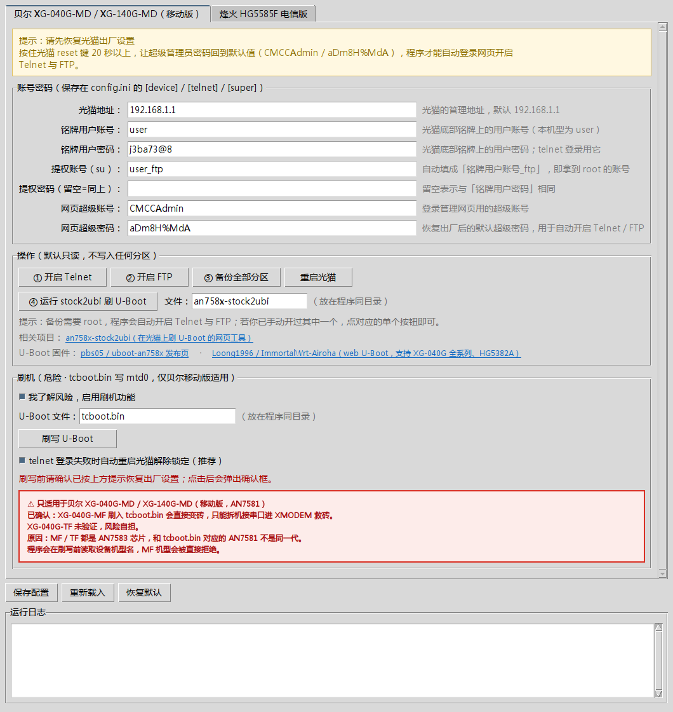
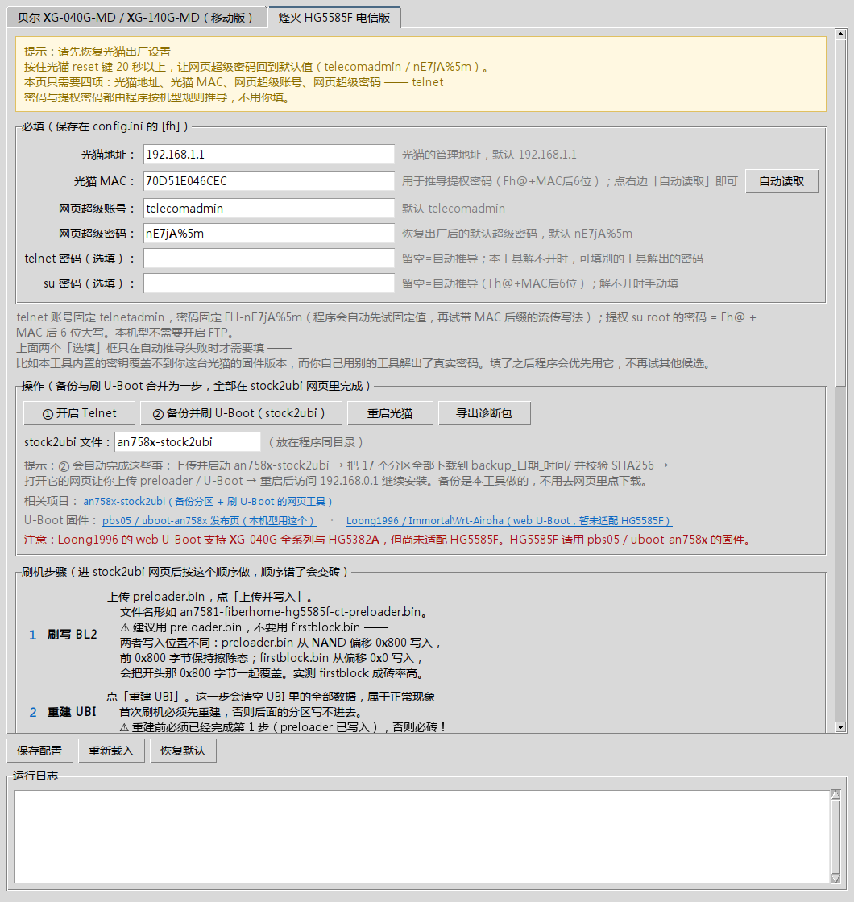
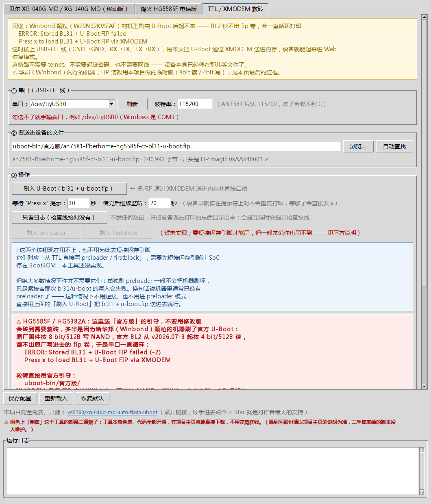

# 邪恶的光猫刷机工具箱（xe-pon-flash-toolkit）

贝尔 XG-040G-MD / XG-140G-MD 与烽火 HG5585F 电信版的一键刷机教程。
刷坏了也不至于扔：接一条 USB-TTL 线，用界面第三个 tab 把 U-Boot 通过
XMODEM 送进内存就能救回来（见「TTL / XMODEM 救砖」）。

> **本项目完全免费、代码全部开源**：<https://github.com/xe5700/xg-040g-md-auto-flash-uboot>
>
> ⭐ 如果这个工具帮到你了，**进仓库点个 Star** 就是对作者最大的支持。
>
> ⚠️ 闲鱼上「倒卖」这个工具的都是二道贩子：工具本身免费、代码全部开源，
> 在项目主页就能直接下载，不用花冤枉钱。遇到问题也请以项目主页的说明为准，
> 二手卖家给的版本没人维护、也更新不了。

## 图形界面（推荐新手用）

不想敲命令的话，直接运行 `gui.py`（Windows 上跑打包好的 `xe-pon-flash-toolkit.exe`）：

```bash
python3 gui.py
```

界面按机型分成 tab，底部是共用的「保存配置 / 重新载入 / 恢复默认」和运行日志。

第一个 tab（贝尔）：



第二个 tab（烽火）：



第三个 tab（**TTL / XMODEM 救砖**）—— 不碰 telnet、不需要超级密码、也不需要
网络，一条 USB-TTL 线直接把 U-Boot 送进内存：



为什么不放一张表单里：贝尔和烽火的流程差别太大 —— 贝尔要开 FTP 才能 `su`、
刷的是 `tcboot.bin`；烽火不用 FTP、备份和刷 U-Boot 都走 stock2ubi 的网页。
塞在一起会有一半控件是灰的，用户很难判断「我现在到底该点哪个」。所以每个
tab 各有各的表单、提示和按钮，互不影响，配置也分开存（贝尔在
`[device]/[telnet]/[super]`，烽火在 `[fh]`，救砖在 `[rescue]`）。救砖 tab 是
**唯一一个独立于机型的 tab** —— 砖了的时候机器已经不在系统里了，没有机型可言。

### 贝尔 tab（XG-040G-MD / XG-140G-MD 移动版）

1. **顶部提示**——常驻黄色提示，说明使用前要先恢复出厂设置（见下文）。
2. **账号密码**——光猫地址、铭牌用户账号/密码、提权账号、网页超级账号密码。
   全部存在同目录的 `config.ini` 里，改完点「保存配置」。
   改铭牌账号时，提权账号会跟着变成「账号_ftp」（例如 `user` → `user_ftp`）；
   手工改过提权账号后程序就不再自动覆盖它。
3. **操作**——`① 开启 Telnet`、`② 开启 FTP`、`③ 备份全部分区`、`重启光猫`，
   都是只读的，不写入设备任何分区。
   Telnet 和 FTP 是两个**独立**按钮：你自己开过 Telnet 但没开 FTP 时，
   只点 ② 就行，程序不会因为 Telnet 已开而跳过 FTP。
4. **刷机**——里面是**两种刷 U-Boot 的方式，只需要用一种**（别两个都点）：
   - **方式 1**：用 `tcboot.bin` 直接写 mtd0，默认**锁定**，必须先勾选
     「我了解风险，启用刷机功能」；
   - **方式 2**：把 `an758x-stock2ubi` 传到光猫上跑起来，备份和刷写都在它的
     网页里完成。**这条不需要勾上面的确认框**（它自己有确认弹窗）。

   两条路只对贝尔移动版有效，效果一样。
5. **运行日志**——和命令行输出完全一样（GUI 直接接管了 `print`）。

### 烽火 HG5585F 电信版 tab

只需要填**四项**：光猫地址、光猫 MAC、网页超级账号、网页超级密码。
telnet 密码（`FH-nE7jA%5m`）和提权密码（`Fh@`+MAC后6位）都由程序按机型
规则推导，不用你填。

另外有两个**选填**框（`telnet 密码`、`su 密码`），只在自动推导失败时才需要
填：本工具内置的密钥覆盖不到你这台光猫的固件版本，而你自己用别的工具解出了
真实密码。填了之后程序优先用它。详见
[两条兜底](#两条兜底手动填密码--导出诊断包)。

1. **MAC 自动读取**——MAC 输入框旁边有「自动读取」按钮，程序直接问设备
   （`GET http://<ip>:8080/cgi-bin/ajax?ajaxmethod=web_get_brmad`，无需登录）。
   输入框**保留**：换了管理口、页面改版、电脑没接 LAN 口时读不到，
   还可以照光猫背面标签手填。
2. **操作**——`① 开启 Telnet`、`② 备份并刷 U-Boot（stock2ubi）`、
   `重启光猫`、`导出诊断包`。
   烽火**没有**单独的「备份」按钮，也没有 tcboot 刷机区：备份分区和写
   preloader / U-Boot 都在 stock2ubi 的网页里完成，对本工具来说就是
   「把工具传上去跑起来 + 打开网页」一件事。后续适配 AN7581 家族
   （HG5382A 等）也走这条，因为 `tcboot.bin` 是专门给贝尔移动版做的。

   「导出诊断包」是 telnet 密码解不开时的兜底：把设备上密码相关的文件、
   密文片段、本地密钥和解密结果打包成 zip 发给作者，全程只读。
3. **U-Boot 固件下载**——操作区下面直接给了两个发布页链接：
   - [pbs05 / uboot-an758x](https://github.com/pbs05/uboot-an758x/releases)
     —— **HG5585F 用这个**，下 `bl31-u-boot.fip`；
   - [Loong1996 / ImmortalWrt-Airoha](https://github.com/Loong1996/ImmortalWrt-Airoha/releases)
     —— web U-Boot，支持 XG-040G 全系列与 HG5382A，但**尚未适配
     HG5585F**，别在烽火上刷。

   贝尔 tab 的操作区也放了同样两个链接（贝尔两种都能用）。

   > ⚠️ **华邦（Winbond）颗粒的机器：先刷「修改版」临时引导，进系统后再换刷
   > 官方版。** HG5585F / HG5382A 有的批次用的是 Winbond **W29N02KVSIAF**：
   > 原厂固件按 **8 bit/512B** 写 NAND，而官方 BL2 从 uboot-an758x
   > `v2026.07-3` 起改成按 **4 bit/512B** 读，直接刷官方 U-Boot 会卡在
   > `ERROR: Stored BL31 + U-Boot FIP failed (-2)` 的循环里（只能 TTL 救砖）。
   > 所以发行包里另外带了一份适配版：
   >
   > - `uboot-bin/修改版/` —— 8bit 读 / 4bit 写的临时引导（文件名带
   >   `-tmp-8bit-read-4bit-write`），**第 ① 步和第 ④ 步先刷它**，机器能起来；
   > - `uboot-bin/官方版/` —— 官方版，**进系统后立刻换刷它**，机器就回到
   >   标准状态（第 ② 步「重建 UBI」会把引导按新格式写回去）。
   >
   > 两个目录都在程序目录里，随 zip 一起发；没走 zip 的去
   > [xe5700 / uboot-an758x-winbond](https://github.com/xe5700/uboot-an758x-winbond/releases) 下。
   > 真的已经砖了就走下面的「TTL / XMODEM 救砖」——**救砖用官方版**。
   > 判断自己这台是不是华邦颗粒：串口开机日志会打印
   > `Parallel NAND: W29N02KVSIAF`，或者 `python3 nandcheck.py <preloader.bin>`。

4. **刷机步骤**——界面上按顺序列出 stock2ubi 网页里要做的 6 步，
   并标出顺序上最容易出事的一条：

   | 顺序 | 网页里的按钮 | 要上传/操作的文件 |
   |---|---|---|
   | ① | 刷写 BL2 | `preloader.bin`（**别用 `firstblock.bin`**，见下方黄框） |
   | ② | 重建 UBI | 直接点，会清空 UBI 内数据 |
   | ③ | 板级数据 | 本工具自动生成的 `factory-1m.bin`（1.0 MiB） |
   | ④ | 刷写 U-Boot | `bl31-u-boot.fip` |
   | ⑤ | 刷写系统 | QWRT / PONWRT 的 `sysupgrade.bin` 或 `.itb` |
   | ⑥ | 启动系统 | 首次约 1~3 分钟，别断电 |

   > ⚠️ **重建 UBI 之后必须刷入 U-Boot**
   >
   > UBI 一重建，装在它 fip 卷里的 `bl31-u-boot.fip` 就没了 —— 不补刷第 ④
   > 步，第 ⑥ 步「启动系统」只会一直循环报
   > `Stored BL31 + U-Boot FIP failed`。
   >
   > **单独重建 UBI 本身不会把机器弄死**：preloader 在 NAND 偏移 `0x800`
   > 的主引导区，UBI 在另一块区域，两边互不影响。补上 U-Boot 就能起来，
   > 实在不行接一根 TTL 线用 XMODEM 把 fip 送进内存也能救回来。

   > ⚠️ **第 1 步用 `preloader.bin`，不要用 `firstblock.bin`**
   >
   > 两者的区别是**写入 NAND 的位置**不同（据 uboot-an758x 作者的说明）：
   >
   > - `*-firstblock.bin` —— 从 NAND **偏移 0x0** 开始整块写入，会把开头
   >   那 `0x800` 字节一起覆盖；
   > - `*-preloader.bin` —— **前 `0x800` 字节保持擦除态**，只从 NAND
   >   偏移 `0x800` 写入 BL2。
   >
   > firstblock 要连带覆盖开头 `0x800`，而各机型那一段的内容并不一样，
   > 写错就起不来 —— 这才是它成砖率高得多的原因。
   >
   > 除非你明确知道自己在做什么、且有 XMODEM 救砖条件，否则别碰
   > `firstblock.bin`。

   **第 ③ 步用 `factory-1m.bin`，不是 `mtd13_factory.bin`。** 原厂的
   factory 分区是 3 MiB 的 JFFS2/UBI 容器，U-Boot 那一栏只认 1.0 MiB。
   本工具在备份完成后会自动从 `mtd13_factory.bin` 里提取 PON 校准和
   Wi-Fi EEPROM，按 OpenWrt 的 1 MiB 布局（`an7581-fiberhome-ubi-parts.dtsi`）
   重新拼一份 `factory-1m.bin` 放进备份目录，日志里会打印读到的
   基础 MAC / PON SN / 整机 SN / 校准数据是否齐全。

   为什么必须做这一步：群里有人刷完 PONWRT 后「无线网和光驱动用不了」，
   就是因为把 3 MiB 的原厂 factory 直接传给了 U-Boot 那一栏。手动生成
   要用 [fiberhome-factory](https://github.com/22p/fiberhome-factory) 图形
   工具，新手极易漏掉。

5. **断电警告**——界面上常驻一条红框警告：刷机过程中绝对不能断电；
   重启后必须立刻访问 `http://192.168.0.1` 继续完成安装；否则光猫变砖，
   只能用 XMODEM 模式救砖。这是作者和群里多位群友踩过的坑。

两个 tab 的内容各自可滚动，右侧有滚动条。

`config.ini` 长这样（可以手工编辑，也可以只用界面）：

```ini
# 设备与网络
[device]
model = bel
router_ip = 192.168.1.1
mac =
auto_enable_telnet = true
auto_enable_ftp = true
skip_backup_if_complete = true

# telnet 登录与提权账号
[telnet]
username = user
password = j3ba73@8
su_user = user_ftp
root_password =

# 网页超级管理员账号（用于自动开启 Telnet / FTP）
[super]
username = CMCCAdmin
password = aDm8H%MdA

# 烽火 tab（与上面几段完全独立，切 tab 时不会互相覆盖）
[fh]
router_ip = 192.168.1.1
mac =
super_username = telecomadmin
super_password = nE7jA%5m

# 串口（TTL / XMODEM 救砖 tab 用；在界面里选完会自动写回这里）
[serial]
enabled = false          # 旧「走 TTL 串口」的开关，已作废，保持 false 就行
port =                   # 例：/dev/ttyUSB0（Windows 是 COM3）
baudrate = 115200

# TTL / XMODEM 救砖 tab（fip 留空 = 运行时按机型自动找官方版）
[rescue]
fip =
wait = 30                # 等 "Press x" 提示的秒数
after = 20               # 传完继续监听多少秒看起没起来
monitor_seconds = 15     # 「只看日志」盯多久

# 安全开关
[safety]
allow_flash = false
```

`root_password` 留空表示**与 telnet 密码相同**（本机型实测就是同一个密码）。

`[fh]` 段只有四项，因为烽火的 telnet 密码和提权密码都是程序按机型规则推的
（`FH-nE7jA%5m` / `Fh@`+MAC后6位），不需要用户填。`mac` 留空时程序会在
登录前自动从设备读回（见「MAC 会自动读」一节）。

### Windows 免安装版

从 [Releases](https://github.com/xe5700/xg-040g-md-auto-flash-uboot/releases)
下载 `xe-pon-flash-toolkit-v<版本>.zip`（已含 exe、tcboot.bin、an758x-stock2ubi），
解压即用。也可以只下 `xe-pon-flash-toolkit-v<版本>.exe` 单文件程序（约 20MB），
**不需要装 Python**：

1. 把 exe 和 `tcboot.bin`、`an758x-stock2ubi` 放在**同一个目录**
   （zip 解开就已经是这个布局）；
2. 双击运行；
3. 界面里填好账号密码，点「保存配置」，会在同目录生成 `config.ini`。

> 附件名带版本号（`xe-pon-flash-toolkit-v2.2.0.exe` 这种），因为 Release
> 页面上会同时躺着多个 tag 的包，同名文件下载到本地根本分不清哪个是哪个。
> 名字全用 ASCII，是因为 GitHub 上传时会**直接删掉文件名里的非 ASCII
> 字符**，附件名和 `SHA256SUMS.txt` 里写的就会对不上，`sha256sum -c`
> 必然报「没有那个文件或目录」。
>
> `an758x-stock2ubi` 不在本仓库里维护，打包时由 `package_release.py`
> 通过 GitHub API 从 [pbs05/an758x-stock2ubi](https://github.com/pbs05/an758x-stock2ubi/releases)
> 取最新 Release 的二进制塞进 zip。它是别人维护的 aarch64 静态 ELF，
> 跟着上游走才不会过期。

注意：
- exe 是 64 位 Windows 程序（Win7 及以上）；
- `tcboot.bin` **已内置在 exe 里**，开箱即用；想换别的版本，把文件放到
  exe 同目录即可（同目录优先于内置副本）；
- 首次运行若被 SmartScreen 拦截，选「更多信息 → 仍要运行」即可（程序未做代码签名）。

### exe 自检（排查缺依赖）

打包成 exe 后 `flash.py` 是运行时动态加载的，万一漏了某个模块，
可以跑自检确认：

```bat
xe-pon-flash-toolkit.exe --selftest
```

它会把依赖逐个导入一遍、加载一次 `flash.py`，结果同时写到程序目录的
`selftest.log`。全部正常退出码为 0；有问题会弹窗并列出缺什么。

加 `--quiet` 可以让它失败时也不弹窗（CI / 无人值守用，只看退出码和日志）：

```bat
xe-pon-flash-toolkit.exe --selftest --quiet
```

### 关于「恢复出厂设置」提示

两个 tab 的顶部各有一条固定的黄色提示，说明**必须先恢复出厂设置**：按住
reset 键 20 秒以上，让超级管理员密码回到默认值（贝尔是
`CMCCAdmin` / `aDm8H%MdA`，烽火是 `telecomadmin` / `nE7jA%5m`），
程序才能自动登录网页去开启 Telnet（贝尔还要开 FTP 才能 `su`）。

这条提示是常驻的使用前提说明，**不跟刷机按钮绑定**——开 Telnet、备份同样
需要超级密码是默认值。

## 系统要求
- **Windows**：直接跑 `dist/xe-pon-flash-toolkit.exe`，无需安装任何东西（见上文
  「Windows 免安装版」）。
- **Linux / WSL / MSYS2**：用 `python3 flash.py`（命令行）或 `python3 gui.py`
  （图形界面）。图形界面需要系统带 tkinter，多数发行版装 `python3-tk` 即可。

## 前置依赖安装

### Python 包
```bash
pip install telnetlib3            # 所有机型都需要（telnet 登录）
pip install fh_tool-cli==0.2.7    # 只有烽火机型需要（fh_tool 加密 RPC）
pip install pyserial              # 只有用「TTL / XMODEM 救砖」tab 时需要
```

三个都是**按需加载**的：贝尔机型没装 `fh_tool-cli` 也能正常跑，
不接串口没装 `pyserial` 也不影响（只有点救砖 tab 上的按钮才会报错并提示
安装）。打包好的 exe 里三个都已内置。

### 系统软件包
**不再需要 netcat**。备份/上传改用临时 HTTP 服务器 + 设备侧 `curl`（见下文
「为什么用 HTTP 而不是 nc」），只依赖 Python 标准库。

## 准备工作

1. **重置路由器**
   - 按住 reset 键 20 秒以上，将设备恢复至出厂设置

   > **已经刷坏了、进不去系统的话**：不用走下面这套流程，直接看
   > 「TTL / XMODEM 救砖」一节 —— 一条 USB-TTL 线就能把 U-Boot 送进去。
   > 机器完全正常、只是想少开两个服务的话，本工具的 telnet 流程仍然是最快的。

2. ~~**登录系统**~~ —— **已自动化，脚本会自动完成**
   - 脚本用超级管理员账号 `CMCCAdmin` / `aDm8H%MdA` 自动登录网页，
     调用 `POST /system.cgi?telnet+on` 开启 Telnet（免拆机），不需要手工点。

3. **开启 FTP 文件共享** —— **已自动化，脚本会自动完成**
   - 脚本登录网页后会自动打开 FTP 服务（`POST /storage.cgi?ftp_config`，
     带会话 `csrf_token`），实测 1 秒内 21 端口即 LISTEN。
   - 这一步不是为了传文件，而是因为 **`su user_ftp` 这个提权账号只在
     FTP 服务启用后才会被创建**（它由 `IGD FTP Server` 动态注入
     `/etc/passwd`）。没开 FTP 时 `su user_ftp` 会报
     `su: unknown user user_ftp`。
   - 检测到 21 端口已开则跳过网页步骤（`AUTO_ENABLE_FTP`）。
   - 脚本**不会**在结束时自动关掉 FTP：关掉会让 `user_ftp` 消失，下次
     运行还得再开一遍，而且万一把设备留在半途更麻烦。介意 21 端口长期
     暴露的话，备份完手工关掉即可。

4. **自动跳过重复备份** —— **已自动化**
   - 每次备份会在目录里写入 `device.json`（设备信息 + 各分区的
     SHA256）。再次运行时若发现**同一序列号**且**校验完整**的备份，
     直接跳过备份，省下 545MB 的传输（见下文「备份清单与跳过逻辑」）。

## 运行模式

脚本默认 **只备份、不刷机**（安全优先）。用 `--mode` 切换：

| 模式 | 作用 | 是否写入设备 |
|---|---|---|
| `--mode telnet` | 仅自动开启 Telnet（不碰 FTP） | 否 |
| `--mode ftp` | 仅自动开启 FTP（不碰 Telnet） | 否 |
| `--mode backup`（默认） | 开启 Telnet+FTP + 备份全部分区 | 否 |
| `--mode flash` | 开启 Telnet+FTP + 备份 + 刷写 U-Boot | **是，危险** |
| `--mode stock2ubi` | 上传 an758x-stock2ubi + 自动备份校验 + 打开网页 | 否（刷写在它网页里做） |
| `--mode report` | 导出诊断包 zip（密码相关文件 + 密文 + 本地密钥表） | 否（只读下载） |
| `--mode ttl` | TTL / XMODEM 救砖：把 `bl31+u-boot.fip` 送进设备内存 | 否（只写内存，不碰 flash） |

用 `--model` 选机型（默认 `bel`）：

```bash
python3 flash.py --model bel      --mode backup   # 贝尔 XG-040G-MD / XG-140G-MD
python3 flash.py --model hg5585f  --mode backup   # 烽火 HG5585F CT
```

图形界面里对应这些按钮（在各自的 tab 里）：

- **贝尔 tab**：操作区是 `① 开启 Telnet`、`② 开启 FTP`、`③ 备份全部分区`、
  `重启光猫`；刷机区是 `方式 1：刷写 U-Boot（tcboot.bin）`（默认锁定，要勾
  「我了解风险」）和 `方式 2：运行 stock2ubi 刷 U-Boot`（不用勾，两种方式
  只用一种）；
- **烽火 tab**：`① 开启 Telnet`、`② 备份并刷 U-Boot（stock2ubi）`、`重启光猫`、
  `导出诊断包`。
- **TTL / XMODEM 救砖 tab**：`刷入 U-Boot（bl31 + u-boot.fip）`、
  `只看日志（检查线接对没有）`，另外两个灰着的按钮（`刷入 preloader` /
  `刷入 firstblock`）还没实现，见「TTL / XMODEM 救砖」一节。

**Telnet 和 FTP 是两个独立开关**，各自单独检测端口：
- 两个都关 → `--mode backup` 会依次自动开启；
- 只开了 Telnet（比如你自己开过）→ 点「② 开启 FTP」单独补上即可；
- 只开了 FTP → 点「① 开启 Telnet」；
- 已经开着的那个会打印「检测到 … 已开启，跳过网页开启步骤」，不会重复操作。

```bash
python3 flash.py --mode telnet     # 最安全，只开 telnet
python3 flash.py --mode backup     # 只备份全部分区
python3 flash.py --mode flash      # 刷机（会要求输入 YES 二次确认）
python3 flash.py --mode stock2ubi  # 上传 an758x-stock2ubi 并在光猫后台跑起来
python3 flash.py --mode report     # 导出诊断包（telnet 密码解不开时发给作者）
python3 flash.py --mode ttl --serial-port /dev/ttyUSB0 --file 官方版/an7581-fiberhome-hg5585f-ct-bl31-u-boot.fip
python3 flash.py --reboot          # 只重启光猫（清掉网页会话 / telnet 锁定）
```

其他选项：
- `--no-enable-telnet`：假定 Telnet 已手动开启，跳过网页步骤
- `--no-enable-ftp`：假定 FTP 已手动开启，跳过网页步骤
- `--force-backup`：即使已存在同一台设备的完整备份，也强制重新备份
- `--stock2ubi-file 路径`：指定 an758x-stock2ubi 文件（默认找程序同目录的同名文件）
- `--stock2ubi-ignore-kernel`：跳过 stock2ubi 启动时的内核 release 检查
- `--no-browser`：`stock2ubi` 模式下不自动打开浏览器（脚本/远程用）
- `-y / --yes`：`flash` 模式下跳过 YES 二次确认
- `-h / --help`：显示用法

### `--mode stock2ubi`：在光猫上跑网页刷 U-Boot

`tcboot` 刷好之后，想换成更现代的 U-Boot 时用这个模式。它会：

1. 自动开 Telnet（需要 FTP 提权的机型还会开 FTP），登录并 `su` 到 root；
2. 把 [an758x-stock2ubi](https://github.com/pbs05/an758x-stock2ubi)
   上传到光猫 `/tmp`，校验 SHA256，`chmod +x`；
3. 用 `nohup … </dev/null &` 在**后台**跑起来（默认监听 `0.0.0.0:3333`），
   这样 telnet 会话断开后它也不会跟着退出；
4. **自动备份全部 17 个分区**到 `backup_日期_时间/`：逐个分区从
   `http://<设备IP>:3333/backup/N` 流式下载，边下边算 SHA256，
   下完写 `device.json` 清单（机型 / SN / 每个分区的大小与哈希）；
5. 等 3333 端口就绪，打印启动日志，然后用系统默认浏览器打开
   `http://192.168.1.1:3333/`。

**备份由本工具做，不用去它网页里再点一次下载。** 原因：

- stock2ubi 只是把 `/dev/mtdN` 原样吐出来，**它自己不做任何校验**；
  本工具会补上大小校验和逐文件 SHA256，并记进 `device.json`；
- 同一台设备（SN 相同）已有校验完整的备份时会直接跳过，省掉 400MB+ 的传输
  （想强制重来加 `--force-backup`）；
- 实测速率 7~11 MB/s，17 个分区约 40 秒。

备份完之后剩下的步骤在**它自己的网页里**完成（本工具不代劳，那是它的界面）：

- 上传对应机型的 `preloader.bin`（**不要用 `firstblock.bin`** —— 它从 NAND
  偏移 0x0 整块写入、会覆盖开头 0x800，实测成砖率高），以及 AN758x U-Boot 的
  `bl31-u-boot.fip`；
- 重启后访问 `http://192.168.0.1/` 继续安装；首次进入恢复页可能要约一分钟。
- ⚠️ **别接 2.5G 口**：新 U-Boot 里没有 2.5G 网口的 PHY 驱动，插着它去访问
  恢复页会拿不到 IP、也打不开网页 —— 请换一个千兆（1G）LAN 口接电脑。

> ⚠️ 刷写过程中**绝对不能断电**，重启后**必须**访问 `192.168.0.1` 继续完成
> 安装，否则光猫会变成砖头，只能用 XMODEM 模式救砖。
>
> ⚠️ 进 U-Boot 恢复页要插**千兆网口**：官方 U-Boot 里没有 2.5G 口的驱动，
> 插 2.5G 口会一直拿不到 IP、网页也打不开（恩山 tid-8491746 的实测结论）。

`an758x-stock2ubi` 本体（aarch64 静态 ELF）放在程序同目录即可，打包 exe 时
会一并带上；也可以直接替换 exe 同目录的那份，不用重新打包。

```bash
python3 flash.py --mode stock2ubi                    # 用同目录的 an758x-stock2ubi
python3 flash.py --mode stock2ubi --stock2ubi-file /path/to/an758x-stock2ubi
```

相关项目：
- [an758x-stock2ubi](https://github.com/pbs05/an758x-stock2ubi) —— 在光猫上跑网页刷 U-Boot
- [uboot-an758x](https://github.com/pbs05/uboot-an758x) —— AN758x U-Boot 本体
- [ImmortalWrt-Airoha · XG-040G-MD-ubi-auto](https://github.com/Loong1996/ImmortalWrt-Airoha/releases#release-XG-040G-MD-ubi-auto-20260927-59)
  —— 现成的 web U-Boot 固件

## 烽火 HG5585F CT 机型

除了贝尔，本工具也支持**烽火 HG5585F CT**（电信版），以及后续的 AN7581
系列。图形界面里切到第二个 tab「烽火 HG5585F 电信版」，命令行加
`--model hg5585f`。两者的差异都在 `models.py` 里：

| | 贝尔 XG-040G-MD / XG-140G-MD | 烽火 HG5585F CT |
|---|---|---|
| 管理网页 | `http://192.168.1.1`（80） | `http://192.168.1.1:8080` |
| 网页超级账号 | `CMCCAdmin` / `aDm8H%MdA` | `telecomadmin` / `nE7jA%5m` |
| telnet 账号 | `user` | `telnetadmin` |
| telnet 密码 | 铭牌上的固定密码 | `FH-nE7jA%5m`（固定值，不带 MAC 后缀） |
| 提权 | `su user_ftp`（密码=telnet 密码） | `su root`，密码 `Fh@` + MAC 后 6 位大写 |
| 提权前要先开 FTP | **是**（`user_ftp` 靠 FTP 服务注入） | 否 |
| 自动开 Telnet | 网页 `POST /system.cgi?telnet+on` | 8080 的 fh_tool 加密 RPC |
| 刷 U-Boot | `tcboot.bin` 写 mtd0 | 走 `--mode stock2ubi` 的网页 |

### MAC 会自动读，不用手抄

烽火的 su 密码**由 MAC 推导**（`Fh@` + MAC 后 6 位），所以程序需要知道 MAC。

但**不需要你去机器背面抄**：设备在 8080 上有个只读接口直接回 MAC，
点界面上的「自动读取 MAC」按钮即可，程序会顺便把能推导的密码填好。

```text
GET http://192.168.1.1:8080/cgi-bin/ajax?ajaxmethod=web_get_brmad
→ {"brmad": "70D51E046CEC", ...}
```

这个接口**无需任何认证**（本来就是给网页 JS 拿 MAC 用的），而 MAC 正是
`fh_tool` 加密的密钥种子 —— 所以「能访问 8080」就等于「能算出密钥」，
这也是 fh_tool 无需登录就能改配置的根本原因。

之所以要自动读而不是让用户抄：MAC 抄错一位，SHA256 出来的 AES 密钥就全错，
设备只会回一个 403，从错误信息完全看不出是「抄错」还是「协议不对」。

自动读取失败时（比如电脑没直连光猫 LAN 口），仍可照背面标签手填，
形如 `70:D5:1E:04:6C:EC`。填好 MAC 后密码框留空即可，程序会自动填出推导结果；
你也可以手填覆盖。

> 网上教程常说烽火 telnet 密码是「`FH-nE7jA%5m` + MAC 后 6 位」。
> 本工具实测的 V4.20.M5000 上**不是**：telnet 密码就是固定值 `FH-nE7jA%5m`。
> 这个结论有三条独立证据：省级预置包里的 `TelnetPassword` 密文用固件自带的
> `libfhcfg.so` 解出来就是这个值；设备 `/var/telnet_passwd` 里 `telnetadmin`
> 的 `$5$` 哈希可被 `openssl passwd -5 -salt fh 'FH-nE7jA%5m'` 精确复现；
> 真机登录成功。若你的固件版本不同、登录不上，可在 `config.ini` 里手填覆盖。

### 开 Telnet 走 fh_tool，不碰网页会话

烽火的网页里没有「一键开 Telnet」的按钮，但设备在 **8080 端口**上开了一个
`fh_tool` 加密 RPC：请求体用 MAC 派生的 AES 加密，所以「知道 MAC」就等于
有权限，**不需要登录后台、也不占用那个唯一的网页会话**。

本工具调用它只需要两步（`fh_tool_cli` 的库函数，不起子进程）：

```python
from fh_tool_cli.backends.fh_tool import api_payload, fh_tool_call
payload = api_payload("TelnetEnable", {"telnet": "1"})
fh_tool_call("192.168.1.1", "70D51E046CEC", payload, 8.0, port=8080)
```

⚠️ MAC 必须传**无分隔符大写**（`70D51E046CEC`）：`derive_crypto()` 直接拿
这个字符串做 SHA256，带冒号算出来的密钥是错的，设备会返回 403。

顺便，同一个 RPC 还能**免登录**读到网页超级账号密码：

```python
fh_tool_call(ip, mac, api_payload("GetAdminAccount"), 8.0, port=8080)
# -> {"adminname": "telecomadmin", "adminpwd": "nE7jA%5m"}
```

（本工具目前只用它开 Telnet；读账号的能力留着备用。）

### 闪存：SPI NAND，颗粒可能因批次不同

HG5585F CT 用的是 **SPI NAND**，不是 eMMC、也不是 NOR。真机上
`/sys/class/mtd/mtd0` 报出来的几何参数：

| 项目 | 值 |
|---|---|
| `type` | `nand` |
| `writesize`（页大小） | 2048 字节 |
| `oobsize`（OOB） | 64 字节 |
| `subpagesize` | 2048 字节 |
| `erasesize`（擦除块） | 131072 字节 = 128 KiB |

容量 **256 MiB**：从 stock2ubi 页面上各分区的物理偏移推出来 —— 最后一个带
物理偏移的分区（`userlocalct`）结束于 `0x0EC00000` = 236 MiB，留 20 MiB 余量
正好填满 256 MiB。`mtd15 apps` / `mtd16 userdata` 没有独立物理偏移，它们是
`mtd10 apps`（120 MiB）里的 UBI 卷，两个加起来 114.44 MiB，放得下。

> ⚠️ **同型号的不同批次，板上焊的闪存未必是同一颗。**
> 本工具在真机上只能读到「是 NAND、128 KiB 擦除块」这些参数，
> **读不到厂商和型号** —— 这版固件把 SPI NAND 驱动编进了内核，
> dmesg 里没有芯片探测日志，也没有 `spi-nand` 的 sysfs 节点。
>
> 所以选 U-Boot / OpenWrt 镜像时，请按你自己这台机器的闪存类型选。
> 拿不准就拆开看芯片丝印，或者先确认镜像说明里的擦除块大小与设备一致 ——
> 擦除块对不上会写不进去，甚至起不来。擦除块是 128 KiB 还是 4 KiB
> （NOR）是最容易区分的一项。

### 烽火不走 tcboot

`tcboot.bin` 是专门给贝尔移动版（econet **EN7581**）做的，只适配移动型号。
同系列的 **XG-040G-MF / XG-040G-TF 用的是 AN7583 芯片**，和 EN7581 不是
同一代，U-Boot 二进制根本不通用 —— 实测已有用户给 MF 刷 tcboot 后**直接变砖**，
只能拆机接串口进 XMODEM 救砖。所以：

- 贝尔 tab 的刷机区会**在写入前读取设备机型名**，MF 机型直接被拒绝；
  TF 未验证，会弹警告要求确认。
- 烽火 tab 里**根本没有** tcboot 刷机区，而是把「备份」和「刷 U-Boot」
  合并成 `② 备份并刷 U-Boot（stock2ubi）` —— 备份由本工具自动做完
  （带 SHA256 清单），刷写部分在 stock2ubi 的网页里完成。
`--mode stock2ubi` 对两个机型都可用。

### 烽火已知限制

- **网页开 Telnet 不可用**：只能靠 fh_tool RPC（本工具已自动做）或手工开。
- **备份未在真机验证**：分区表是从设备 `/proc/mtd` 实时读的，逻辑与贝尔
  共用；但烽火真机上的备份流程还没有完整跑过一遍，请先确认 `--mode backup`
  的产物大小与 `device.json` 里的记录一致再考虑后续操作。
- **FTP 不开**：烽火提权不需要 `user_ftp`，所以工具不会去开 21 端口。
- **华邦（Winbond）颗粒的机器要「先临时、后官方」刷两遍**：见上面
  「U-Boot 固件下载」那段红框。直接用官方引导会卡在
  `Stored BL31 + U-Boot FIP failed (-2)` 循环里，只能走 TTL 救砖。

## TTL / XMODEM 救砖（第三个 tab）

> **这一节讲的是新功能。** 早期版本里那个「走 TTL 串口」勾选框（把串口当成
> telnet 的替代通道去备份/刷机）**已经作废、并从界面上撤掉了**，原因见本节
> 最后一小节。现在 TTL 只有一个入口：救砖。

设备刷坏之后（典型是卡在 `ERROR: Stored BL31 + U-Boot FIP failed (-2)`，然后
一直循环打印 `Press x to load BL31 + U-Boot FIP via XMODEM`），网页和 telnet
都已经没有了，唯一还能说话的通道就是串口。这个 tab 就干一件事：**把
`bl31-u-boot.fip` 通过 XMODEM 直接送进设备内存跑起来**，进了 U-Boot 再回网页
重建系统。

这条路的性质：**只往内存里送数据、不写 flash**，所以它不会让砖变得更严重。

### 接线

- 一根 **USB-TTL 串口线**（CH340 / CP2102 / FT232 都行，3.3V）
- 主板上的 4 个焊盘，一般丝印是 `VCC GND TX RX`（有的板子是 `3V3 GND TXD RXD`）
- **TX 接 RX、RX 接 TX**，GND 必须共地，**VCC 不要接**（光猫自己供电）
- 串口参数：**115200 8N1**，无流控（AN7581 只认这个，改了收不到）

### 用法

界面：

1. 「TTL / XMODEM 救砖」tab → ① 点「刷新」选串口；列不出来就直接手打
   （Linux 是 `/dev/ttyUSB0`，Windows 是 `COM3`）
2. ② 选要送进去的 FIP：点「自动查找」会**按当前机型**在程序目录里挑一个
   **官方版** `*bl31-u-boot.fip`（`uboot-bin/官方版/`，随 zip 一起发），
   也可以用「浏览…」自己选
3. ③ 点「刷入 U-Boot」→ 确认 → 等日志走完（340 KB 大约 35 秒）
4. 传完设备**就已经在 U-Boot 里了**（不用再重启）：按住 reset 进 Web 恢复
   模式，或者在串口里按 `Ctrl-C` 打断后敲 `httpd dhcp`，再开
   `http://192.168.0.1/`
   （⚠️ 去开这个页面要插**千兆口**：U-Boot 里没有 2.5G 口的驱动，
   插 2.5G 口会一直拿不到 IP、页面打不开）
5. 在网页里**重建 UBI 并重刷系统**
6. **验收标准：拔掉 TTL 线，断电重启三次，次次都能自己起来。**
   只做到第 4 步的话，下次重启还会回到同一个错误（UBI 还是老格式写的）。

命令行等价写法：

```bash
python3 flash.py --mode ttl --serial-port /dev/ttyUSB0 \
    --file uboot-bin/官方版/an7581-fiberhome-hg5585f-ct-bl31-u-boot.fip

python3 ttl_rescue.py --list                  # 先看有哪些串口
python3 ttl_rescue.py --port /dev/ttyUSB0 --monitor   # 只看日志，判断线接对没有
```

命令行下 `--file` 和 `--serial-port` 都会转发给 `ttl_rescue.py`，也可以直接
用它自己的参数（`--wait`、`--after`、`--retry`、`--no-force-x` …）。

### 华邦颗粒的机型：这里要用官方版引导

会砖到需要救砖，多半就是**给华邦（Winbond）颗粒的机器刷了官方 U-Boot**：
原厂固件按 **8 bit/512B** 写 NAND，而官方 BL2 从 v2026.07-3 起按 **4 bit/512B**
读，读不出原厂写进去的 fip 卷，于是串口一直循环。而 XMODEM 是把 FIP **直接送
进内存、根本不经过 NAND 读取**，官方版在这一步一定跑得起来。

所以：**救砖这条路上用官方版引导，别用修改版。** 修改版是给「进系统后把闪存
按新格式重写」那条流程用的，在「烽火 HG5585F 电信版」tab 里。界面上也做了
三重拦截：自动查找不列修改版、文件名带 `-tmp-8bit-read-4bit-write` 或躺在
`uboot-bin/修改版/` 里的一律跳过、你手动选到它时提示行会变红。

### 线接错了会告诉你哪里不对

串口接反、波特率不对、端口选错的时候收到的都是乱码。工具会统计收到的字节里
**可打印 ASCII 的占比**，低于阈值就判定为乱码，并打印一份排查清单：当前串口
（含 `/dev/serial/by-id/` 里读出来的 CH340 型号）、波特率、接收字节数、原始
字节快照（hexdump），以及按顺序排查的四条建议（TX↔RX 是否交叉、GND 是否共地、
波特率是不是 115200、串口是不是选错了）。日志会同时写进
`_out/ttl_rescue_时间戳.log`，窗口关掉现场也还在。

### 两个还没做的按钮

「刷入 preloader」和「刷入 firstblock」是灰的。它们对应「从 TTL 直接写
preloader / firstblock」，需要**先短接闪存引脚让 SoC 停在 BootROM** 才有效，
本工具还没实现。而且绝大多数情况下并不需要它们：单独刷 preloader 一般不会
把机器刷坏，只是紧接着那次 bl31/u-boot 的写入会失败 —— 换句话说机器里通常
已经有 preloader 了，这种情况不用短接、也不用进 preloader 模式，直接用上面
的「刷入 U-Boot」把 `bl31 + u-boot.fip` 送进去就行。

### 关于旧的「走 TTL 串口」（已作废）

早期版本在贝尔 tab 上有一个「走 TTL 串口」勾选框：`serial_shell.py` 把
pyserial 包装成**和 `telnetlib3.Telnet` 一样的接口**（`write` / `expect` /
`read_until` / `read_very_eager` / `close`），让串口对象直接当 `tn` 用，于是
整套备份/刷写/回读校验逻辑原样复用，还能跳过「开 Telnet」「开 FTP」两步。

**这个功能已经不在界面上了**（`serial_shell.py` 本身还留着），原因是它解决的
不是真问题：能拆机接线的人，随便一个串口终端就是 root shell，用工具再跑一遍
telnet 流程没有额外价值；而真正需要 TTL 的场合是**救砖** —— 那时候机器停在
BootROM / U-Boot，根本进不了系统，老功能一个字节都帮不上。所以 TTL 的入口
收敛成了现在这个专门的救砖 tab。

## 配置和刷入

1. **修改脚本配置**
   - 根据你的光猫型号，修改 `flash.py` 脚本中的相关配置
   - 重要项：`PASSWORD`（telnet 密码，通常印在光猫**底部铭牌**上）、
     `SU_USER`（提权账号，本机型为 `user_ftp`）、`MODE`（默认运行模式）
   - 本机型实测：`PASSWORD = "j3ba73@8"`，`SU_USER = "user_ftp"`，
     且 `su user_ftp` 的密码**就是** telnet 密码（`TELNET.su_password` 跟随
     `TELNET.password`，机型档案里 `su_password` 为空即表示「同上」）

2. **获取 uboot 文件**
   - `tcboot.bin` 来自 **NWRT**——是 nwrt 专门为这款光猫开发的 tcboot
   - 网站地址：https://nwrt.kuroneko.host/
   - 刷完 tcboot 重启后，可以进 tcboot 换成更现代化的新 U-Boot：
     - **一键换法（推荐）**：用 `--mode stock2ubi`（界面上是刷机区里的
       「方式 2：运行 stock2ubi 刷 U-Boot」，不用勾「我了解风险」那个确认框）。它会把
       [an758x-stock2ubi](https://github.com/pbs05/an758x-stock2ubi)
       上传到光猫后台跑起来，再打开它的网页，在里面备份分区、上传
       `preloader.bin`（别用 `firstblock.bin`）和
       [uboot-an758x](https://github.com/pbs05/uboot-an758x) 的
       `bl31-u-boot.fip`，重启后访问 `http://192.168.0.1/` 继续安装
       （**用千兆口**：U-Boot 里没有 2.5G 口的驱动，插 2.5G 口拿不到 IP）。
       详见上面的「`--mode stock2ubi`」一节。
     - 也可以直接刷现成的 web U-Boot 固件：
       [Loong1996 的 ImmortalWrt-Airoha（XG-040G-MD-ubi-auto）](https://github.com/Loong1996/ImmortalWrt-Airoha/releases#release-XG-040G-MD-ubi-auto-20260927-59)
     - **ponwrt** 也兼容，可直接刷
   - 刷 QWRT 有两条路线，别搞混：
     - **tcboot 直接刷 QWRT**：一步到位，不需要拆分；
     - **刷到 webuboot / uboot-an758x 再上 QWRT**：需要把 QWRT
       **拆分成两个包分别刷入**，见
       https://github.com/xe5700/qwrt_for_uboot-an758x
       （uboot-an758x 本体：https://github.com/pbs05/uboot-an758x）

3. **运行刷入脚本**
   ```bash
   python flash.py --mode flash
   ```

## 刷写后的回读校验（重要）

写完 U-Boot **不能马上回读判定**——这一条是实测踩出来的。

原因：`dd of=/dev/mtdblock0` 写的是**块设备**，数据先落到 block 层的页缓存；
`dd` 返回时 mtdblock 只是收到了请求，真正「擦除 + 写入 flash 芯片」由内核的
`mtd_blktrans` 线程异步完成，**可能还在队列里**。而校验读的 `/dev/mtd0` 是
**字符设备**，直读芯片、不经过块层缓存。所以刚写完就读，读回来的还是旧数据，
过几秒到几十秒才变成新数据。

因此 `flash_uboot()` 的校验是**轮询等待**，不是读一次：

1. `dd` 写入后先检查返回码（`echo DD_RC=$?`），非 0 直接报错退出；
2. 循环执行 `sync` → `dd if=/dev/mtd0` → `sha512sum`，每次间隔
   `FLASH_VERIFY_INTERVAL` 秒；
3. 哈希与期望一致即判定成功并打印是第几次回读命中的；
4. 超过 `FLASH_VERIFY_TIMEOUT` 秒仍不一致才判失败（这时才提示"请手动还原，
   以免变砖"）。

两个参数默认 **120 秒 / 5 秒**，够 512KB 的 U-Boot 生效（实测几秒到几十秒）。
可以在 `config.ini` 的 `[safety]` 段调整：

```ini
[safety]
allow_flash = false
flash_verify_timeout = 120     # 最长轮询秒数
flash_verify_interval = 5      # 每次回读间隔秒数
```

校验用 `/dev/mtdN`（字符设备，直读芯片）而**不是** `/dev/mtdblockN`
（块设备会命中 mtdblock 自己的缓存，可能读到还没写下去的旧数据）——
这个区别正是上面那个坑的根源。

## 为什么用 HTTP 而不是 nc

早期版本用 `dd | nc` 传分区，主机侧必须**精确卡时间**先起 `nc -l` 监听，
设备才敢连。任一环节慢一拍就丢数据（实测表现为备份文件 0 字节），
而且每个分区就是一次独立竞态。

现在改成：主机用标准库起一个临时 HTTP 服务器，设备侧用自带的 `curl` 上传：

```
dd if=/dev/mtdN bs=1M | curl -s -T - http://<主机IP>:8080/mtdN_name.bin
```

HTTP 是请求-响应模型，没有竞态；每个分区独立一次 PUT，失败可单独重试；
传输完还会用**从设备实时读取的分区表**逐分区校验字节数，不符立即中止。

本机型实测 `/sbin/curl` 为 **curl 7.77.0**（OpenSSL 1.1.1d，支持
http/https/ftp/tftp）。脚本启动前会探测 curl 是否存在。

两种方式产出的镜像已做字节级比对：**15/17 分区 SHA256 完全一致**，
仅 `log`（内核持续写日志）和包含它的 `all_flash` 不同，属预期行为。

## 分区表是实时从设备读取的（重要）

早期版本把 XG-040G-MD 的 17 个分区名与大小**写死在脚本里**。这在其它机型上
会直接失败 —— 不同型号/固件的分区**数量和大小都不一样**，例如电信的
`XG-040G-TF` 分区布局就与移动版不同，备份时会因「大小与分区表不符」中止。

现在改为：telnet 登录后先执行 `cat /proc/mtd`，实时解析出本机的真实分区表，
再用它驱动整个备份流程：

```
dev:    size   erasesize  name
mtd0: 00080000 00020000 "bootloader"
mtd1: 00040000 00020000 "romfile"
...
```

解析结果会打印出来，形如：

```
[*] 已从设备读取分区表：共 17 个分区
    mtd0  bootloader          524288 字节 (0.5 MiB)
    mtd1  romfile             262144 字节 (0.3 MiB)
    ...
```

分区**数量、名字、大小**全部以设备为准，因此：

- 备份按设备真实分区逐个进行，不再限定 17 个；
- 备份文件命名用**真实分区号**（`mtd{i}_{name}.bin`），分区号不连续也不会错位；
- 完整性校验比对的是本机实时分区表，换机型不会误报；
- 备份超时按各分区实际大小计算。

读不到 `/proc/mtd`（或解析不出任何行）时会回退到内置的默认表并给出警告，
提示把输出反馈给作者。内置默认表只是**兜底**，正常流程不会用到。

## 备份清单与跳过逻辑

本工具**同样能备份完整固件**，不只是为了刷机前留个后路：`--mode backup`
会把设备 `/proc/mtd` 里的全部分区原样 dump 到电脑上（贝尔 17 个、烽火 17 个，
含 bootloader、kernel、rootfs、config、factory 等），每个分区都有大小与
SHA256 校验，产物可以直接用 `dd` 写回去或者拿 U-Boot 的工具链解析。
烽火还会额外生成一份 OpenWrt 用的 1 MiB `factory-1m.bin`（见上文）。

每次备份完成后，脚本会在备份目录里写一份 `device.json`：

```json
{
  "device": {
    "SerialNumber": "NBELFCFD60A5",
    "Hostname": "HLSC-XG140GMD-NBELFCFD60A5",
    "ModelName": "XG-140G-MD",
    "Manufacturer": "NBEL",
    "HardwareVersion": "XG140GMDV10",
    "SoftwareVersion": "NXGS1426V07t01",
    "ProductClass": "XG-140G-MD",
    "MacAddress": "04:56:65:40:a8:27"
  },
  "files": { "mtd0_bootloader.bin": { "size": 524288, "sha256": "60e4…" }, … }
}
```

再次运行时，脚本会按目录名倒序扫描 `backup_*`，找到**第一个**满足
下列全部条件的目录就跳过备份：

1. `device.json` 存在，且 `SerialNumber` 与当前设备**完全一致**
   （任一为空都判为不通过，保守处理）；
2. 分区文件齐全，字节数与清单、**本机实时分区表**三方吻合；
3. 每个文件的 SHA256 与清单记录一致。

任一条不满足就重新备份。想强制重来用 `--force-backup`。

- 机型/序列号来自设备本身：`cfgcli -g InternetGatewayDevice.DeviceInfo.*`
  取型号与厂商；**序列号取 `hostname` 的最后一段**，因为 `cfgcli -g` 的
  `SerialNumber` 被固件脱敏成 `******`。
- `MacAddress` 取 `cat /sys/class/net/br0/address`。

## 常见问题

### 提示"用户 CMCCAdmin 已经登录，请稍后重试"
光猫**同一时间只允许一个网页会话**。如果浏览器里还开着管理页面，脚本就登录不上去。
处理办法（二选一）：
- 关掉浏览器里的管理页面，等它自动超时释放；
- 直接重启光猫清掉会话：`python3 flash.py --reboot`

### 重启光猫（`--reboot` / 界面「重启光猫」）
调用管理页的 `POST /system.cgi?reboot`，等于网页上的「设备重启」按钮。
实测设备会下线约 20 秒后恢复，`uptime` 归零确认真的重启了。

⚠️ 端点必须是 `/system.cgi?reboot`。**不要**用 `/devicemanagement.cgi`——
那个页面是「恢复配置」，它只认 `?restore` 和 `?restore_factory`，
后者是**恢复出厂设置**，会清掉超级密码和全部配置。

### 提示 telnet 认证失败 / 300 秒锁定
光猫**连续 3 次认证失败会锁定 telnet 约 300 秒**。锁定期间请不要重试，
重启可立刻解除：
```bash
python3 flash.py --reboot
```
另外请确认配置区的 `PASSWORD` 是**光猫底部铭牌上的 telnet 密码**，
它和网页超级密码 `aDm8H%MdA` 不是同一个。

### 提示 telnet 密码错误（烽火：程序会自动找回）

烽火的 telnet 密码存在固件里，网上流传的 `FH-nE7jA%5m` 只对**没改过密码**
的机器有效。装维改过密码后就会陷入死锁：要读配置得先有 telnet，要有 telnet
得先知道密码。

这个工具会自动打破死锁 —— 走烽火在 8080 端口上那个**无需登录**的
`fh_tool` 接口（密钥就是 MAC，而 MAC 又能免认证读到）取回真实密码。

**顺序很重要：先比哈希，对不上才解密。**

1. **先取设备上的密码文件**：`DownloadFile` 把 `/var/tel_passwd` 拉回本地。
   这个文件是 `用户名:哈希:...` 格式（哈希由 libc 的 `crypt()` 生成，
   实测 HG5585F 是 sha256-crypt `$5$fh$...`，贝尔/老固件可能是 md5-crypt
   `$1$...`）。拿候选密码在**本地**算哈希去比对 —— 对上了说明密码肯定正确，
   一次 telnet 认证机会都不浪费。
   （烽火连错 3 次就锁 300 秒，所以这一步必须发生在任何 telnet 连接之前。）
2. **对不上再解密**：说明装维改过密码。用 `DownloadFile` 把
   `/fhrom/fhconf/param.pdt.enc` 拉回来，用固件里的 AES 工作密钥解出明文
   （`fhdecrypt.py`）。老固件没有这个文件时，会退到
   `/fhdata/pre_usrconfig_conf`（省份预置包，里面也是同一套加密的
   `option TelnetPassword '2506...'`）。
3. `GetTelnetInfo` 若存在也会先试一次（设备直接吐账号密码，最省事）。

**候选密码分两类，只有第一类会在线试：**

| 用途 | 内容 | 是否连 telnet |
| --- | --- | --- |
| 在线试 | 机型档案固定值 `FH-nE7jA%5m` + 流传的 MAC 后缀变体（最多 3 个） | 是，3 次就锁 |
| 仅本地比对 | `admin/Fh@+MAC后6位`、`root/hg2x0`、`admin/admin`、`telecom/nE7jA%5m`、`admin/abcd` 等弱口令 | **否**，只在本地算哈希 |

第二类来自论坛与社区汇总（HG5585F / HG5140A / HG6145D 等型号），绝大多数机器上
都是错的。有了 `/var/tel_passwd` 里的哈希，这些候选在本地算哈希是免费的，命中
才去登录；没命中就完全不会碰 telnet。如果把十几组弱口令直接拿去在线试，必然把
设备锁死 300 秒。

取回的密码只用于**本次运行**，不会写进 `config.ini`。整个过程不消耗 telnet
认证次数。

`/var/tel_passwd` 由 telnetd 启动时按配置生成，所以它反映的是**当前生效**的
密码，装维改过也是最新的。

也可以手动离线解密 —— 拿到配置文件（`param.pdt.enc`，或任意包含它的
rootfs 分区镜像）后：

```bash
python3 fhdecrypt.py /path/to/param.pdt.enc
# TelnetUserName = telnetadmin
# TelnetPassword = FH-nE7jA%5m
# TelnetEnable = 0
# TelnetPort = 23
```

只解一个密文值也行：

```bash
python3 fhdecrypt.py --value 2506000049ECBE32C8DE760F0E960B0F0A53953F
```

> 密钥表按**固件版本**索引（目前验证过 `V4.20.M5000`）。换固件后密钥可能不同，
> 表里没命中时会明确报错而不是给出乱码 —— 猜错比报错更糟。

#### 两条兜底：手动填密码 / 导出诊断包

自动找回也可能失败 —— 新固件换了密钥表，或者装维改密码的方式不在这几条
路径上。这时候有两个出口，都不用改代码：

**① 手动指定密码（界面「telnet 密码（选填）」「su 密码（选填）」）**

如果你已经用别的工具（论坛脚本、厂商工具、自己逆向）拿到了真实密码，直接填
进烽火 tab 那两个「选填」框即可。程序会**优先**用它，不再试其他候选：

```
[手填] telnet 候选: ['MYPWD123', 'FH-nE7jA%5m']
[手填] su 候选:     ['MYSU456']
```

这两项存在 `config.ini` 的 `[fh]` 段，永远不会被机型档案覆盖（和贝尔那套
`[telnet]` 的 `password` 不一样，那个切换机型时会被重写）。留空就是默认行为。

**② 导出诊断包发给作者**

界面「导出诊断包」按钮，或命令行：

```bash
python3 flash.py --mode report --model hg5585f
```

它从光猫只读下载密码相关文件、切出密文片段、逐个试本地密钥，把结果打包成
`fh_report_<时间>.zip`：

| 文件 | 内容 |
| --- | --- |
| `README.txt` | 设备身份 + 收集结果 + **已解出的密码相关字段**（直接列在最上面） |
| `device.json` | 型号 / SN / MAC / 固件版本 / 编译时间 |
| `attempts.json` | 每个路径的下载结果、每段密文的 offset/hex/解密判定 |
| `keys.json` | 本工具内置的密钥表（k2 只给前 16 字节） |
| `env.json` | 工具版本 / Python / 平台 |
| `files/` | 设备上原样导出的文件（已拆掉外层 tar） |

作者看 `attempts.json` 里的 `verdict` 就能判断属于哪种情况：

- `解密成功` → 密码就在明文里，是工具的候选表该更新；
- `所有已知密钥都解不出可打印明文` → 固件换了密钥，需要新的 k2/iv2；
- `容器头不在已知密钥表里` → 换了加密方式或新的容器格式。

实测一台 HG5585F 取到 7/13 个文件、24 段密文全部解开，README 顶部直接给出
`TelnetPassword = FH-nE7jA%5m`。取不到的（`param.pdt.enc`、`calidata`、
`/etc/shadow`）是因为 `DownloadFile` 只放行 `/fhconf/` 和 `/fhdata/` 两个
目录，换固件可能就放行了，所以仍然每次都会试一遍。

> ⚠️ 诊断包里有设备 MAC、PON SN、整机 SN、telnet 密码哈希，可能还有 Wi-Fi
> 名称/密码。**只发给作者，不要公开贴到论坛或群里。**

### 提示"获取 root 权限失败"
备份和刷写都需要 root 权限，非 root 下 busybox 会直接拒绝执行 dd：

```
dd: you have no permission to run this applet!
```

（`/dev/mtd*` 是 `crw-rw---- root root`）。

**本机型已打通的提权路径**（实测验证）：

```
telnet 登录 user / j3ba73@8     → $ 提示符，uid=1001(user-telnet)
su user_ftp                     → Password: 输入 j3ba73@8
                                → # 提示符，uid=0(root)  ← 直接就是 root
```

要点：
- **`su user_ftp` 的密码就是 telnet 密码**，不需要另外找第三方凭据。
- **前提是网页上已启用 FTP 服务**。`user_ftp` 账号在启用 FTP 之前
  **不存在**于 `/etc/passwd`（那时只有 `root` / `user-common` /
  `osgi_admin` / `user-telnet`），所以会报 `su: unknown user user_ftp`。
- 拿到 root 后 `dd if=/dev/mtd8 of=/dev/null` 返回 `rc=0`，备份才能进行。

历史上探测失败、现已排除的 su 目标（留档以免重走弯路）：

| su 目标账号 | 结果 |
|---|---|
| `useradmin_ftp` | 该账号在这版固件里不存在 → `su: unknown user` |
| `user-telnet` | 能用 telnet 密码进入，但只是回到自身，无提权 |
| `osgi_admin` | 密码均被拒（`Error!`） |
| `user-common` | 密码均被拒（`Error!`） |
| `root` | 密码既不是 telnet 密码、也不是网页超级密码，均被拒 |
| `user_ftp` | ✅ **成功，直接得到 uid=0(root)** |

### 提示"未收到 Login: 提示" / 连接后立即断开
这台光猫对 telnet 有**静默限流**：短时间内连续连接时，TCP 握手成功，
但 telnetd 立刻关闭连接且不发任何 banner。这不是 300 秒认证锁定
（锁定会有明确的 `forbidden` 提示）。每次失败重试都会重新计时，
需要安静等待几分钟才会恢复。工具已把重试间隔退避到 30 秒；
如果你自己手工反复试连接，请耐心等待，或用 `python3 flash.py --reboot` 重启后再试。

### telnet 账号不对？
不同型号/固件的 telnet 账号不一样（有的 `useradmin`，有的 `user`）。
默认开启 `AUTO_DETECT_USERNAME`，脚本会从网页登录页自动读出该机型实际的账号；
读不到时按 `USERNAME_CANDIDATES` 顺序尝试。

## 注意事项
- 请确保在操作前已备份重要数据
- 刷机过程请勿断电，避免设备变砖
- 建议先跑 `--mode backup` 确认流程通畅、拿到完整备份，再考虑 `--mode flash`
- **已验证机型**：`XG-040G-MD` 和 `XG-140G-MD` 两台均实测通过；
  **电信 TF 机型未验证，应该用不了**，其他型号请自行判断
- 如遇问题，请参考 NWRT 网站的相关文档

## 致谢 / Acknowledgements

这个工具能跑起来，靠的主要是别人把最难的活儿先干完了。尤其要谢 **pbs05**：
他的 U-Boot 与 stock2ubi 是整个刷机流程的地基 —— 少了它们，本工具能做的
就只有开 Telnet 和备份。

### U-Boot / 引导 / 刷机工具

| 项目 | 作者 | 本工具跟它的关系 |
|---|---|---|
| [uboot-an758x](https://github.com/pbs05/uboot-an758x) | pbs05 | **官方版引导**：`preloader.bin`（BL2）、`firstblock.bin`、`bl31-u-boot.fip`（BL31+U-Boot），Airoha AN7581 / AN7583 通用，自带 U-Boot 网页恢复模式。刷机的 6 步顺序、firstblock 与 preloader 的区别，全部来自它的说明 |
| [uboot-an758x-winbond](https://github.com/xe5700/uboot-an758x-winbond) | xe5700 | 上面那个的 fork：针对华邦颗粒（`W29N02KVSIAF`）改成「8 bit 读、4 bit 写」的临时引导，专门用来进华邦机器的系统。发行包里的 `uboot-bin/修改版/` 就是它 |
| [an758x-stock2ubi](https://github.com/pbs05/an758x-stock2ubi) | pbs05 | 免拆刷机的核心：在原厂系统上跑起一个网页，分区备份 / 刷 BL2 / 重建 UBI / 刷 U-Boot 都在它的网页里完成 |
| [ImmortalWrt-Airoha](https://github.com/Loong1996/ImmortalWrt-Airoha) | Loong1996 | Airoha 平台的 ImmortalWrt 固件与 web U-Boot（带网页恢复模式）。发行包里的 `uboot-bin/loong1996/` 是按机型从它的 release 取的 |
| [atf-airoha](https://github.com/Ansuel/atf-airoha) | Ansuel | ARM Trusted Firmware 的 Airoha 移植 —— BL2 怎么识别闪存、用几位 ECC，全在这份代码里 |
| [make_airoha_atf](https://github.com/xinyooo/make_airoha_atf) | xinyooo | 自己编译上面那份 ATF 用的工具与环境 |

### 排查与救砖（华邦 ECC 那一课）

- **lyq1996** —— 在 [uboot-an758x issue #21](https://github.com/pbs05/uboot-an758x/issues/21)
  里把华邦机型变砖的根因写清楚了：原厂（tcboot/BL2 与内核）整片按 **8 bit BCH**
  读写，而官方 BL2 自 `v2026.07-3` 起按 Winbond ONFI 标称的 **4 bit** 读写，
  两种解码器错位就会静默损坏数据。本工具的 `nandcheck.py`、以及「修改版引导」
  这条路，思路直接来自这份分析。
- **mylucien** —— 在 [issue #22](https://github.com/pbs05/uboot-an758x/issues/22)
  里给出「TTL 提示 `Press x` 时用 XMODEM 把 `bl31-u-boot.fip` 送进内存」的
  救砖办法并实测成功。本工具救砖 tab 就是把这条路做成了点一下。
- **erroljay-stack** —— 同样是 issue #21，提醒「刷完能进系统」不等于修好：
  重启后照样报 `Stored BL31 + U-Boot FIP failed (-2)`。本工具把「拔掉 TTL 线、
  断电重启三次都能自起」写成验收标准，就是因为这条提醒。
- **pbs05** —— 在两个 issue 里逐个回复疑问：「烽火机型变体较多，有的版本用不了
  这个工具」「BL2 上传 preloader 还是 firstblock 本质上是一样的」「XMODEM 传完
  立刻按住 reset 进 WebUI 恢复模式」。
- **恩山无线论坛**（right.com.cn）关于 HG5585F 的两个帖子（tid 8483906、8491746）
  提供了实操经验，包括「刷完先别用 2.5G 口，那个口在新 U-Boot 里没有驱动」
  这类只看代码看不出来的细节。

### 工具

本项目使用了 **billion-context** —— 一个面向小上下文窗口的上下文压缩插件，
兼顾省 token 与超长会话；其内核为 **acp-kernel**。

- billion-context：<https://github.com/ranxianglei/billion-context>
- acp-kernel：<https://github.com/ranxianglei/acp-kernel>

两者均采用 MIT 许可，并附有「产品出处标注」附加条款；
本页即为该条款所要求的署名位置。

### 第三方代码

`fhfactory.py`（备份后自动生成 OpenWrt 用的 1 MiB factory 镜像）是
[fiberhome-factory](https://github.com/22p/fiberhome-factory) 的 Python 移植：

- 上游作者：22p
- 上游许可：**GPL-2.0-only**
- 移植范围：`src/model.rs` 的 1 MiB 布局与身份字段处理、`src/import.rs` 的
  UBI/UBIFS 与 JFFS2 解析、PON 校准格式转换、Wi-Fi MAC 派生

**因此 `fhfactory.py` 这一个文件按 GPL-2.0-only 分发**，不是 AGPL-3.0。
如果只使用贝尔机型（不触发烽火备份），程序不会 import 它。
其余文件按本仓库 LICENSE（AGPL-3.0-only）分发。

> 直白说：这两个许可是**并列**的 —— 碰到 `fhfactory.py` 就按 GPL-2.0-only 的
> 规矩来（改过它再分发时，按 GPLv2 提供对应源码），仓库里其他部分按
> AGPL-3.0。发布二进制发行包时，把这段说明一起保留即可。

## 许可 / License

本项目以 **GNU Affero 通用公共许可证第 3 版（AGPL-3.0-only）** 分发，
全文见 [LICENSE](LICENSE)。

    Copyright (C) 2025-9999 xe5700 <xe5700@outlook.com>

老版本用的是 WTFPL v2。那个协议对「改一改就闭源拿去卖」没有任何约束，
而本工具早就不是个简单的刷机脚本了：它内置了 preloader / U-Boot 的机型
匹配与 NAND ECC 兼容性判断（`nandcheck.py`）、会把整机固件写进光猫、
还带着上游的移植代码 —— 这些东西出错是要把别人的机器刷成砖的。
所以换成 AGPL-3.0：你照样可以随便用、随便改、随便分发，但只要改了再
发布，就必须把改后的源码一起放出来；把它做成联网服务给别人用，也要
按第 13 条提供源码。

### 你可能想知道的两件事

- **我自己刷机、自己改着玩，要开源吗？** 不用。AGPL 只管「分发」和
  「通过网络提供服务」这两件事，自己在家用没有任何义务。
- **我想把这个工具打包进自己的教程 / 镜像里发出去？** 可以，保留
  `LICENSE` 和版权声明，并把源码（包含你的改动）放在同一处提供即可。

## 开发者：自己编译 exe / 发版

版本号的唯一来源是 `version.py`，**不要手改**，用发版脚本改。

### 编译 Windows exe（Linux 上用 wine）

```bash
./build_exe.sh                # 全自动：装 wine 前缀 + Windows Python + 依赖 + 打包 + 自检
./build_exe.sh --rebuild-python   # 重新安装 Windows Python
./build_exe.sh --no-selftest      # 跳过打包后的自检
```

脚本会复用 `_winbuild/` 里已有的 wine 前缀和 Windows Python（该目录不入库，
但**不要删**——重装很慢）。产物为 `dist/xe-pon-flash-toolkit.exe`，
并顺带用 `package_release.py` 打成 `dist/xe-pon-flash-toolkit-v<版本>.zip`
（exe + tcboot.bin + an758x-stock2ubi，就是 Release 上提供的那个包）。

`package_release.py` 还会额外生成 `dist/release/`：里面是带版本号、
纯 ASCII 名的副本（`xe-pon-flash-toolkit-v<版本>.zip` / `.exe`）和与之
一致的 `SHA256SUMS.txt`，专门给 GitHub Release 用。原因见上文
「Windows 免安装版」的说明 —— GitHub 会删掉附件名里的非 ASCII 字符，
与其让它隐式改名，不如自己先定名。

> 改了 `flash.py` 必须重新跑 `build_exe.sh`：它是运行时动态加载的，
> 直接替换 exe 同目录的 `flash.py` 也能生效，但想让改动进 exe 就得重打包。

### 发版（自动改版本号 + 打 tag + 触发 CI）

```bash
./release.sh patch            # 末位 +1（修 bug）
./release.sh minor            # 中间位 +1（加功能）
./release.sh major            # 首位 +1（不兼容大改）
./release.sh 1.4.2            # 直接指定版本号
./release.sh patch --dry-run  # 只打印要做什么，不落盘
./release.sh --current        # 查看当前版本
```

> 仓库里有一个早期手工发布的 Release「V2.0」（大写 V，tag 指向还没有
> `version.py` 的旧提交），所以当前版本号是 `2.1.0`，下次发版即 `v2.1.0`。
> CI 只认小写 `v*` 标签，手打 `V2.1` 不会触发编译。

脚本会：改 `version.py` → 校验读回一致 → 提交 → 打带注释的 tag → 推送。
推送后 GitHub Actions 自动编译 exe 并挂到 Release 附件里。

`--dry-run` 还会顺带打印**本次 Release 的更新日志预览**，
让你在推送前就能看到会写进 Release 说明的内容。

> 发版前工作区必须是干净的（脚本会检查），否则 tag 会指向一个不含改动的提交。

### 更新日志是自动生成的

Release 说明里的「更新日志」由 `changelog.py` 从 git 历史生成，
按提交前缀（`feat` / `fix` / `docs` / `ci` …）分组：

```bash
python3 changelog.py              # 当前 HEAD 到最近一个 tag 之间的提交
python3 changelog.py v2.1.0       # 指定 tag（CI 里传 $GITHUB_REF_NAME）
python3 changelog.py --range      # 只打印用到的提交区间，便于排查
```

所以**提交信息的前缀直接影响更新日志**：

| 前缀 | 归到哪一组 |
| --- | --- |
| `feat:` | 新功能 |
| `fix:` | 修复 |
| `perf:` | 性能优化 |
| `refactor:` | 重构 |
| `docs:` | 文档 |
| `test:` | 测试 |
| `ci:` / `build:` | 构建 / CI |
| 其它 / 没有前缀 | 其他改动 |

几个刻意的设计：

- 认不出前缀的提交**不会丢**，一律进「其他改动」——历史里那些
  `Update README.MD` 之类的老提交也能正常显示；
- `release.sh` 自动产生的 `release: vX.Y.Z` 提交只是改版本号，
  对用户没意义，会被跳过；
- 上一个 tag 用 `git describe` 找，找不到（首次发版）就列出全部提交；
- 生成失败**不会让发版挂掉**，只是 Release 说明里少这一段（CI 里发警告）。

> 因此 CI 的 `actions/checkout` 必须 `fetch-depth: 0` + `fetch-tags: true` ——
> 否则浅克隆里既看不到历史提交也看不到 tag，更新日志会变成空白。
> 这也是为什么每次发版前建议用规范的提交前缀写 commit message。

### GitHub Actions

`.github/workflows/build.yml` 在推 `v*` tag 时自动：
装 Python 3.11 → 装 `telnetlib3` + `pyinstaller` → `py_compile` 语法检查 →
PyInstaller 打包 → 检查产物大小 → 跑 `--selftest --quiet` 确认依赖齐全 →
用 `package_release.py` 打成 zip 并生成 Release 附件 →
上传 Artifact → 用 `changelog.py` 生成更新日志 → 创建 Release 并附上
`xe-pon-flash-toolkit-v<版本>.zip`、`.exe` 与 `SHA256SUMS.txt`。

> 如果 tag 对应的 Release 已存在（例如想修一个发错的 Release），
> CI 会改成**更新说明 + 覆盖附件**，而不是失败。

- tag 与 `version.py` 不一致会直接失败（防止打了 tag 忘了改版本号）；
- 对 `master` 的普通 push 只打包上传 Artifact，不发 Release；
- 也可在 Actions 页面手动 Run workflow。

exe 的「属性 → 详细信息」里能看到版本号，由 `build_exe.spec` 从
`version.py` 现生成 `_version_info.txt` 注入。
